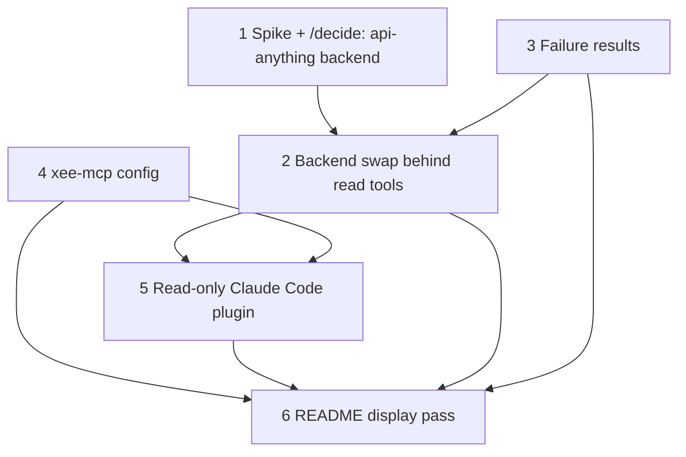

# Spec: crossbar steals — working read tools, failure results, client config, README

Status: draft, unbuilt · 2026-11-09 · Project stays ⏸️ Paused (user, 2026-11-09). This spec waits for the OSS block.
Source: vault `Knowledge/Competitors/Xee-mcp vs crossbar.md` (steal rows S1–S3, moves M1–M3).
Terms: [docs/GLOSSARY.md](../GLOSSARY.md).

## Problem Statement

Both read tools (`search`, `user_tweets`) have returned the `upstream` hint since 2026-05-18, so
Xee-mcp does nothing useful after `xee-mcp init`. The backend (twikit) has had no code commit
since 2025-04 (vault `[I]`#11). On 2026-11-08 x.com moved its frontend to a Vite build under
`abs.twimg.com/x-web` (crossbar commit `3b0b096`), so the webpack `ondemand.s` lookup twikit
depends on has moved further out of reach.

Three smaller gaps sit around that:
- A read tool failure is a `RuntimeError` string (`tools.py` `_wrap_twikit_error`), so the model
  calling a read tool has to parse prose to tell an `auth` failure from an `upstream` one.
- Wiring a client means hand-editing `/ABSOLUTE/PATH/TO` placeholders (`examples/`, README Quickstart step 3).
- The README comparison table leaves out crossbar, the one no-API alternative whose reads work.

## Solution

1. Prove, with one live call, whether api-anything can serve the two read tools from a vendored op
   file in local-only mode. Record the outcome as a `[D]` via `/decide`.
2. If yes: swap the backend behind the same two read tools, same arguments, same post fields.
3. Every read tool failure becomes a failure result with a failure class and a `next` step.
4. `xee-mcp config` prints the client config for each client with absolute paths filled in.
5. A read-only Claude Code plugin, pinned to a tag, installs from this repo.
6. README display pass: crossbar row, nav row, "What you can ask", badges.

Terminal node 6 = the feature as asked: crossbar's functions and display, adapted to a read-only Xee-mcp.
Roots: 1, 3, 4.

## User Stories

1. As a user, I want `search` to return posts, so that Claude can read what X says about a topic.
2. As a user, I want `user_tweets` to return a handle's recent posts.
3. As a user, I want the post fields to stay as they are today (`id, text, author, author_name,
   created_at, url, reply_count, retweet_count, favorite_count, view_count`), so that prompts and
   scripts written against v0.1 keep working.
4. As a user, I want Xee-mcp to be unable to post, like, follow or DM in every install path,
   including the plugin, so that its read-only promise holds structurally.
5. As a user, I want nothing about my searches or calls sent to api-anything's shared catalog.
6. As the model calling a read tool, I want each failure result to carry a failure class, so that I tell the user
   to run `xee-mcp init --force` on `auth` and stop retrying on `upstream`.
7. As the model calling a read tool, I want a `next` line in each failure result that says what to do.
8. As a user, I want `xee-mcp config` to print a client config I can paste, with absolute paths, so
   that Claude Desktop starts the server even though it does not load my shell PATH.
9. As a Claude Code user, I want `/plugin marketplace add Aiyo28/Xee-mcp` to install a read-only
   plugin pinned to a release tag.
10. As a visitor, I want the README to show what I can ask, where Xee-mcp stands against crossbar,
    and how to wire a client, without reading past the first screen to find it.

## Implementation Decisions

**Existing patterns this keeps, and why**
- Two read tools only (repo CLAUDE.md gotcha 5): a new tool needs a ROADMAP entry first. crossbar's
  other 14 read ops are not added here.
- Read-only is law (gotcha 1). With api-anything that becomes structural: the op file contains only
  ops with `readOnly: true`, and the backend never passes `--allow-writes`.
- Cookie file path via `XEE_MCP_COOKIES`, never logged (gotcha 2). The cookie file stays the input;
  the backend imports from it.
- The `auth` vs `upstream` split already exists (`_wrap_twikit_error`, `[D]`#10): it stopped
  users re-running `init` when the cause was upstream. Failure classes keep that split as data.
- Bare `xee-mcp` runs the server (`cli.py`), so existing client configs keep working. Keep it.

**Modules**

| Module | Interface | Hides |
|---|---|---|
| backend (`client.py`) | `call(op, args) -> dict` returning api-anything's answer shape (`ok`, `class`, `tier`, `data`, `reason`) | Installing the op file under `API_ANYTHING_HOME`, importing the cookie file, `API_ANYTHING_LOCAL_ONLY=1` on every subprocess, a pinned `api-anything@<version>`, `--max-tier`, never `--allow-writes`, a timeout |
| read tools (`tools.py`) | `search(query, limit)`, `user_tweets(handle, limit)` → list of post dicts or a failure result | Op arguments (`searchPosts` `query/product=Latest/count`; `getUser` then `userTweets`), mapping api-anything entries to today's post fields, mapping failures to failure classes |
| failure result (`tools.py`) | `{ok: false, class, reason, next}` with MCP `isError: true` | The class table: backend `auth` → `auth`; parser or transaction-id breakage → `upstream`; bad handle/query → `input`; X challenge or rate limit → `blocked`; anything else → `error` |
| client config (`cli.py config`) | `xee-mcp config [--client claude-desktop|claude-code|cursor]` prints to stdout, writes nothing | Absolute path of the `xee-mcp` script (`shutil.which`), the expanded cookie file path, each client's format |
| plugin (`.claude-plugin/`) | `plugin.json` + `marketplace.json` with `source: "./"` | `uvx --from git+https://github.com/Aiyo28/Xee-mcp@<tag> xee-mcp`, no write tools to hide because none exist |

**Backend transport.** The api-anything Python client is git-install only, and PyPI rejects a
published package with a direct URL dependency. So the backend runs the `api-anything call` CLI as
a subprocess (JSON on stdout, non-zero exit on failure) instead of importing the Python client.
Node 22.13+ becomes a runtime requirement. That reverses `[D]`#3's stack lock ("no comparable
cookie-auth lib" in Node). Slice 1's `/decide` records the new `[D]`; README, `llms.txt`,
`pyproject.toml` description and repo CLAUDE.md "Stack" line change in slice 2.

**Op file.** Vendored from crossbar's `spec/x.json` (MIT, crossbar `3b0b096`) with only
`getUser`, `searchPosts`, `userTweets` kept. Its header credits crossbar and keeps the MIT notice.
A copy api-anything healed is kept, and only replaced on `xee-mcp init --force`, the same rule as
crossbar's `installSpec`.

**Supply chain.** Pin the npm version. Before the first `npx`, check that the npm maintainer
(`goodnight00`) still matches the GitHub owner (`goodnight000`). The vault api-anything note flags the mismatch.

## Testing Decisions

- Test behaviour through the read tools and the CLI, with the backend's subprocess call faked. That
  is the same seam `tests/test_cli_init.py` uses for `_load_browser_jar`.
- Read tools: a fake api-anything answer maps to today's post fields (extend `tests/test_serialize.py`);
  each failure class maps from its fake answer (extend `tests/test_error_routing.py`).
- Read-only: the shipped op file contains no op with `readOnly` false; the backend's argv never holds `--allow-writes`.
- Local-only: every backend subprocess env has `API_ANYTHING_LOCAL_ONLY=1`.
- `xee-mcp config`: output holds absolute paths only (no `~`, no bare `uv`), one test per client.
- Plugin: `claude plugin validate .` passes.
- Live smoke stays manual (`docs/release.md` § Live smoke), and slice 1 records its tier numbers.

## Slices

| # | Slice (one vertical path) | Type | Blocked by | User stories |
|---|---|---|---|---|
| 1 | Spike: one live `searchPosts` and one `userTweets` call through `api-anything call` with the vendored op file and `API_ANYTHING_LOCAL_ONLY=1`, cookies imported from the cookie file; then `/decide` swap vs archive | HITL | — | 1, 2, 5 |
| 2 | Backend swap: `client.py` backend + `tools.py` mapping, twikit removed, Node requirement documented | AFK | 1, 3 | 1, 2, 3, 4, 5 |
| 3 | Failure results with failure classes and `next`, on today's twikit backend | AFK | — | 6, 7 |
| 4 | `xee-mcp config` for Claude Desktop, Claude Code, Cursor | AFK | — | 8 |
| 5 | Read-only plugin pinned to a tag | HITL | 2, 4 | 9 |
| 6 | README display pass (+ `llms.txt` tool and status lines) | AFK | 2, 3, 4, 5 | 10 |

**Acceptance criteria**
- **1:** Both calls recorded with `ok`, `tier` and `ms` in a dated line in this file's Further Notes.
  Answers whether the flat `{name: value}` cookie file imports via `--cookies` or needs converting.
  A `[D]` written via `/decide` that either supersedes `[D]`#3's twikit lock or archives Xee-mcp and
  points its README at `crossbar setup --read-only`.
- **2:** `docs/release.md` live smoke prints non-zero results for both read tools. All tests green,
  `ruff` clean. `twikit` gone from `pyproject.toml`. The op file has 3 ops, all read-only, with the
  MIT credit.
- **3:** Each failure class has a test. A client sees `isError: true` and a JSON body with
  `class` and `next`. `COOKIE_HINT`/`UPSTREAM_HINT` text survives as `next` values.
- **4:** `xee-mcp config` output pasted into Claude Desktop starts the server. Unit tests show
  absolute paths for all three clients. It writes no file.
- **5:** Needs the v0.1.0 tag, which waits on `[S]`#11 (stateless vs legacy MCP spec) and your call
  to tag. `claude plugin validate .` passes. A fresh `/plugin install` lists exactly `search` and `user_tweets`.
- **6:** H1 and first paragraph unchanged (gotcha 6). Comparison table has a crossbar row, stated
  fairly: it wins on working reads and setup, Xee on read-only and footprint. "What you can ask" has
  5 prompts. The Status block matches slice 1's outcome.

Builder: 6 slices, not a single chain → `/implement-spec` (slices 3 and 4 can start now; 1 needs you and your cookies).

## Out of Scope

- crossbar's other read ops (home timeline, threads, bookmarks, notifications, DMs): ROADMAP first.
  `replies` and `bookmarks` are already v0.2 entries there.
- Any write op, `x-engager`, `x-write-like-me`: read-only is law.
- `crossbar setup`-style writing into client config files: `config` only prints.
- Skills and subagents shipped with the plugin.
- The `[S]`#11 stateless-vs-legacy MCP decision. It gates slice 5's tag, but this spec doesn't decide it.
- Lifting the Pause in `Projects/INDEX.md`.

## Non-Goals

Generic checklist: `~/.claude/skills/_shared/non-goals.md`.

| # | Looks like success | Actually means |
|---|---|---|
| 1 | Slice 2's tests are green | They run on a faked backend. Without slice 1's recorded live calls and slice 2's live smoke, the read tools are still unproven |
| 2 | "Read-only" in the README | It doesn't count if the op file still holds write ops or `--allow-writes` can reach argv. Structural only |
| 3 | "Nothing leaves your machine" | It doesn't count if local-only was set once at setup and not on every subprocess env, or if npx runs `@latest` |
| 4 | The crossbar row in the README | Written to make Xee look better, it hides that crossbar's reads work today |
| 5 | The plugin installs | Pointing at unpinned `master` reintroduces the supply-chain weakness this spec criticizes in crossbar |

## Further Notes

- **Open: plugin cookie path.** The plugin cannot rely on `XEE_MCP_COOKIES` being set in the user's
  environment. Falling back to `init`'s default `~/.config/xee-mcp/cookies.json` when the env var is
  unset reads against gotcha 2 ("never hardcode"). Decide before slice 5.
- **Open: tier 3.** For reads, tier 3 runs the x.com page in the user's browser profile. Slice 1
  decides the `--max-tier` default. If most calls need tier 3, that is slice 1's archive signal.
- **Resolved (slice 3, 2026-11-09): `isError` with a structured body.** On `mcp` 1.27.0, FastMCP
  passes a returned `CallToolResult` through only when the tool is annotated `-> CallToolResult`.
  Cost: the read tools no longer advertise an `outputSchema`. Success still sends one text block per
  post plus `structuredContent: {"result": [...]}`, the same as before. Verified over stdio.
- **Built, uncommitted (2026-11-09):** slice 3 (`tools.py` `ToolFailure` + `_classify_twikit_error`,
  `server.py`) and slice 4 (`cli.py` `config`). 65 tests, ruff clean. README still describes
  the old wiring until slice 6.
- Risk: api-anything has one maintainer (vault api-anything note, update 2026-11-09). Pinning
  bounds the blast radius but does not remove it.
- Slice 1 results: _(dated line goes here)_
